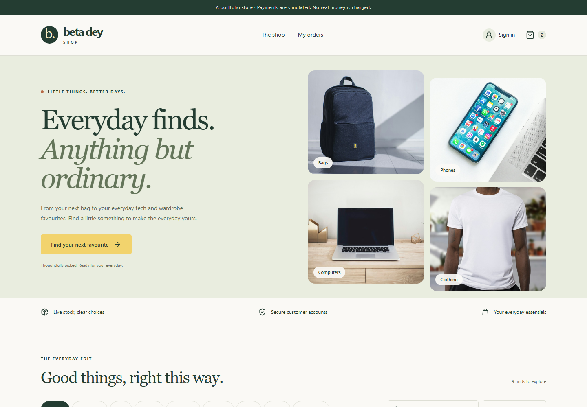
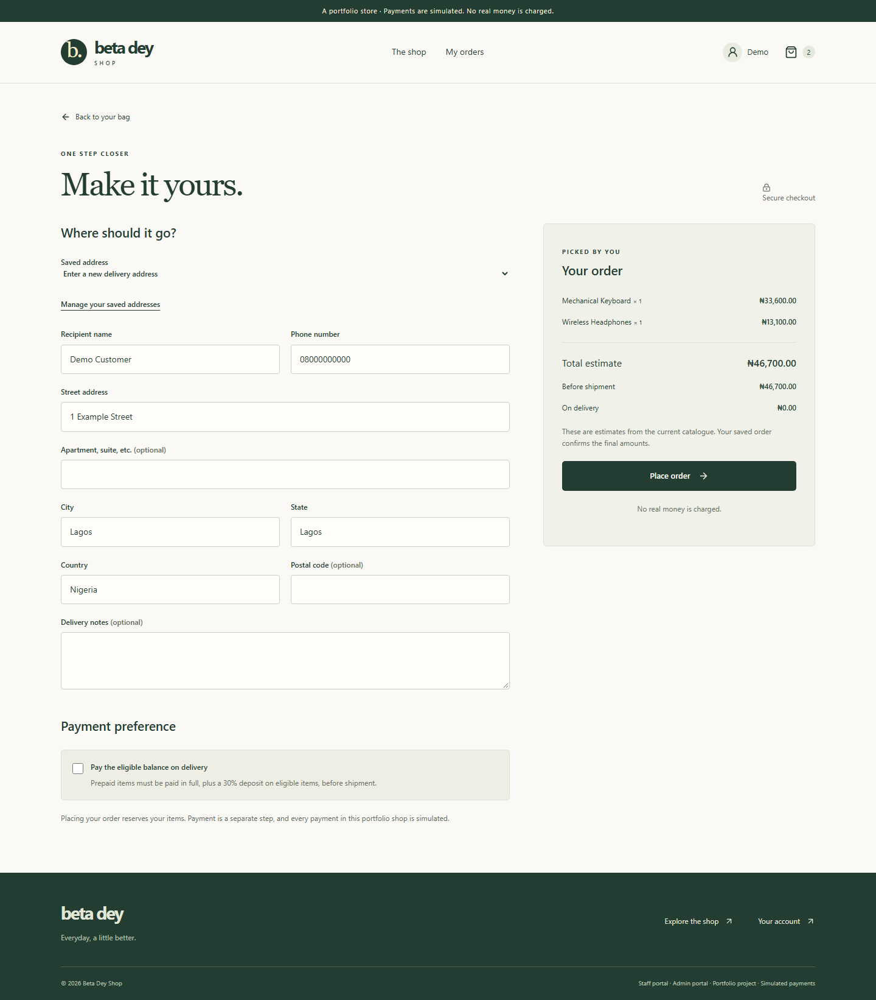
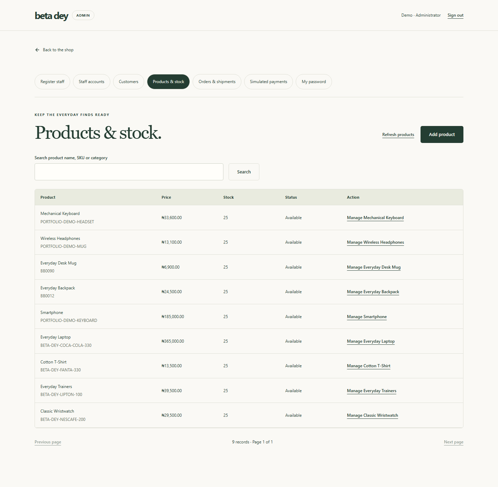
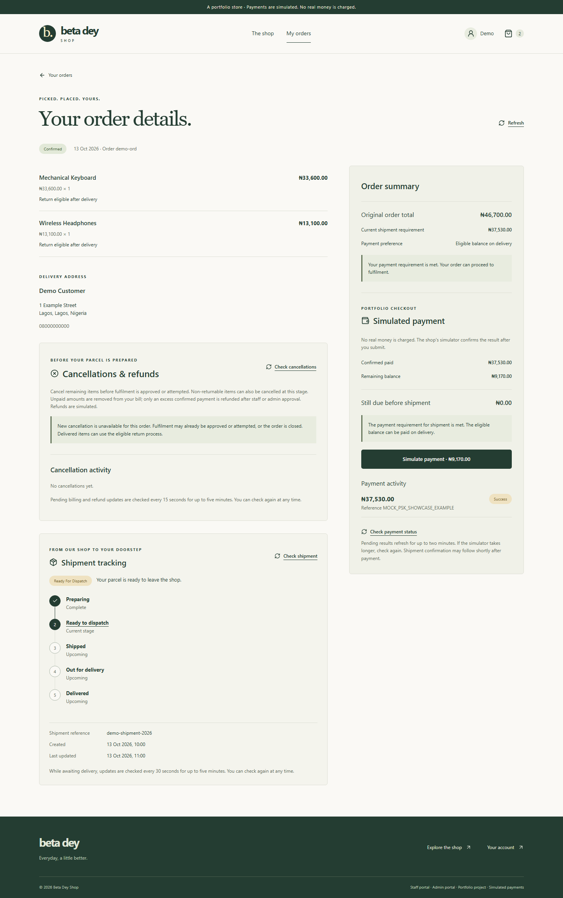
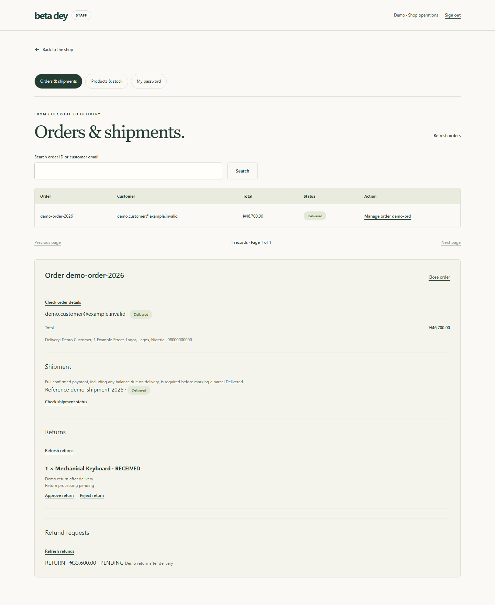
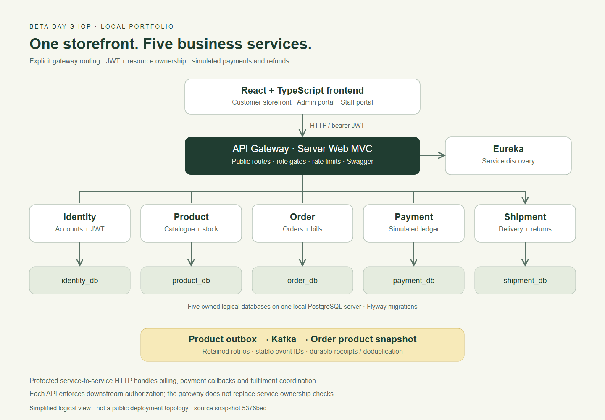
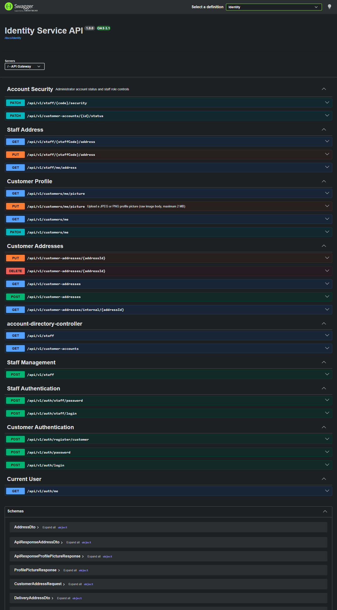

# Beta Day Shop

### A full-stack commerce portfolio: from shopping bag to delivery and inspected returns

Java 25 · Spring Boot · React · TypeScript · PostgreSQL · Kafka · Docker

**This repository is the public presentation package for a locally demonstrated application.** It contains screenshots, selected code pictures, architecture, API documentation previews, and engineering notes. The runnable application and its complete source remain in the [private source repository](https://github.com/Uexcel2022/beta-day-shop). Access to that repository requires the owner's permission.

Payments and refunds are simulated in NGN. No real money is charged. There is currently no public application deployment.

**Public showcase:** [Uexcel2022/beta-day-shop-showcase](https://github.com/Uexcel2022/beta-day-shop-showcase)

[Visual gallery](docs/SCREENSHOT-GALLERY.md) · [Architecture](docs/ARCHITECTURE.md) · [Code highlights](docs/CODE-HIGHLIGHTS.md) · [API overview](docs/API-OVERVIEW.md) · [Testing evidence](docs/TESTING.md) · [Local presentation](docs/LOCAL-DEMO.md)

## What the application does

| Customer experience | Staff and administrator experience |
| --- | --- |
| Register, sign in, retain a session across refresh, and edit profile/password | Admin creates staff accounts; staff must replace their temporary password on first login |
| Crop a profile photo and manage saved delivery addresses | Admin manages staff roles/status/addresses and customer account status |
| Browse products, view pictures, adjust shopping-bag quantities, and check out | Manage products, product photos, stock and restocking |
| View owned orders, pay through the simulator, and track shipment | Review orders and bills, progress shipments, inspect returns, and approve refunds |
| Request eligible returns and follow refund status | Enforce role restrictions and preserve auditable payment/refund records |

### Business rules demonstrated

- **Mixed payment preferences:** non-payment-on-delivery items must be paid in full before shipment, plus a 30% deposit on eligible payment-on-delivery items. The saved order confirms the amounts.
- **Delivery requires full payment:** the system checks confirmed funds before accepting the delivered transition. An unavailable payment verification does not become a successful delivery.
- **Inspection before a return refund:** non-returnable items are rejected; eligible returns progress through receipt and approval before simulated payout and stock restoration.
- **Cancellation refunds require approval:** excess confirmed payment is held for staff/admin approval rather than paid automatically at customer request.
- **Ownership checks:** customers can access their own profiles, addresses, orders, bills, payments, and related shipment/return data. Another customer's identifier does not grant access.
- **Safe retries:** order/payment/refund operations use durable user-scoped idempotency; the frontend retains an uncertain checkout/payment intent for recovery.

## See the application

The frontend pictures show the **actual React application with synthetic presentation data**. They illustrate the UI; they are not proof of real purchases or a hosted deployment. No real customer records or working credentials appear in the gallery.

| Shopping and checkout | Operations |
| --- | --- |
|  |  |
|  |  |

See [all desktop and mobile screens](docs/SCREENSHOT-GALLERY.md), including profile, addresses, staff registration, delivery, and returns.

## Architecture

The React frontend calls an explicit API Gateway. Eureka supplies service discovery for five business services. Identity issues JWTs, while shared security and each downstream service continue enforcing authorization and ownership. Each business service owns a separate logical PostgreSQL database. Kafka carries product catalogue/stock events into Order's product snapshot using an outbox and durable event receipts.

The gateway is the browser entry point; internal service calls and callbacks use protected service-to-service paths. See [the architecture notes and tradeoffs](docs/ARCHITECTURE.md).

| Layer | Technologies |
| --- | --- |
| Backend | Java 25, Spring Boot 3.5, Spring Cloud, Spring Security, JPA, Maven |
| Routing and resilience | Spring Cloud Gateway Server Web MVC, Eureka, OpenFeign, Resilience4j |
| Data and events | PostgreSQL 16, Flyway migrations, Apache Kafka, transactional outbox and event deduplication |
| Frontend | React 19, TypeScript, Vite, Tailwind CSS, React Router, TanStack Query |
| Verification and packaging | JUnit/Spring tests, Vitest/Testing Library, real-stack browser checks, GitHub Actions, Docker Compose, Caddy |

## API documentation

Five generated OpenAPI documents are available through one local Swagger UI. The gallery contains real Swagger captures from the local gateway, with no authorized session or submitted API writes.

[Identity, Product, Order, Payment and Shipment API gallery](docs/API-OVERVIEW.md). Local addresses only work when the private application is running on the viewer's computer.

## Engineering highlights

| Design choice | Why it matters |
| --- | --- |
| [Authorize before idempotent replay](docs/CODE-HIGHLIGHTS.md#1-user-scoped-idempotency) | A saved response cannot bypass ownership checks; reusing a key with different input is rejected |
| [Verify payment before delivery](docs/CODE-HIGHLIGHTS.md#2-confirmed-payment-before-delivery) | Staff cannot finish an underpaid order, including payment-on-delivery orders |
| [Retain failed outbox messages](docs/CODE-HIGHLIGHTS.md#3-durable-kafka-outbox-retry) | Broker failures leave retryable work; stable events and durable receipts prevent duplicate stock adjustments |
| [Persist an uncertain checkout intent](docs/CODE-HIGHLIGHTS.md#4-checkout-recovery) | A refresh or interrupted response can recover the original order using its saved key and payload |

## Verification

Recorded GitHub Actions results for source commit **5376bed** on **13 October 2026** show successful Maven, PostgreSQL/Kafka integration, full-stack browser, and Docker deployment workflows. Recorded deployment verification includes **203 frontend tests across 17 files**; the live browser report contains **11 passing transactional checks**.

This showcase packaging session captured the UI and documentation; it did not rerun the entire application test suite. [Evidence, coverage, and practical limits](docs/TESTING.md) distinguish the recorded CI checks from the synthetic gallery.

## Local showcase and scope

A presenter with source access can demonstrate registration, checkout, simulated payment, staff fulfilment, inspected return/refund, stock restoration, and ownership denial locally. [Presentation guide](docs/LOCAL-DEMO.md).

The local demo scope is complete. Public hosting, real payment processing, password recovery/email verification, distributed rate-limit storage, and background-event correlation are separate future work. Customer email remains read-only. Rate limits currently use per-instance memory; this is not a claim of a production deployment or load-tested capacity.

## Source and project owner

- Owner: [Uexcel2022](https://github.com/Uexcel2022)
- Complete application: [beta-day-shop — private source repository](https://github.com/Uexcel2022/beta-day-shop)
- Source snapshot documented here: `5376bed5e8130698a943c1dfad0d18910f81e516`
- Showcase prepared: **17 October 2026**

The source link may display a 404 to visitors without access. The gallery and technical notes in this showcase are independently browsable. See [image credits](CREDITS.md), [publication steps](docs/PUBLISHING.md), and a [CV-ready project entry](docs/CV-ENTRY.md).
