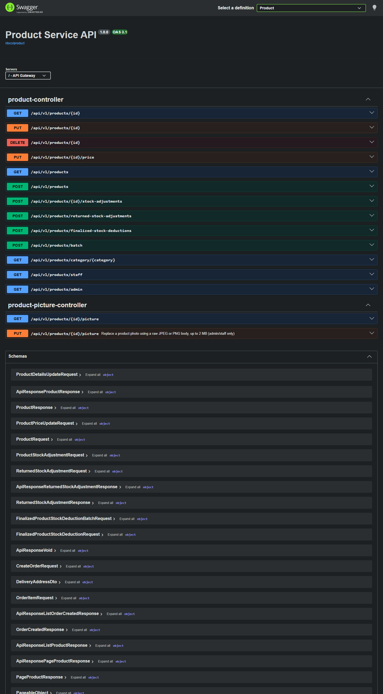
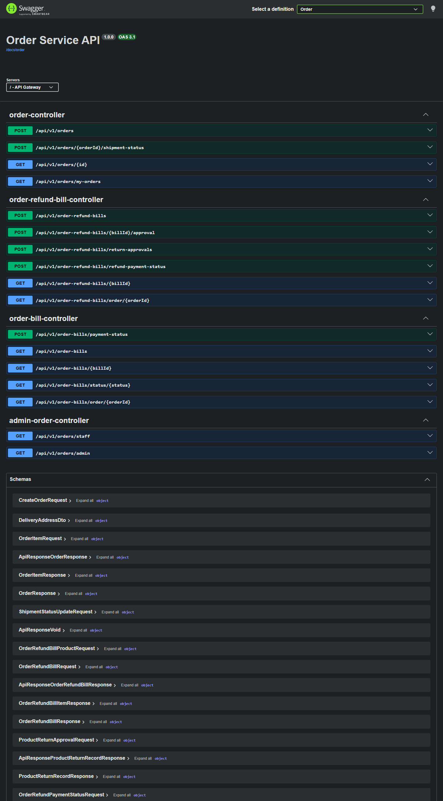
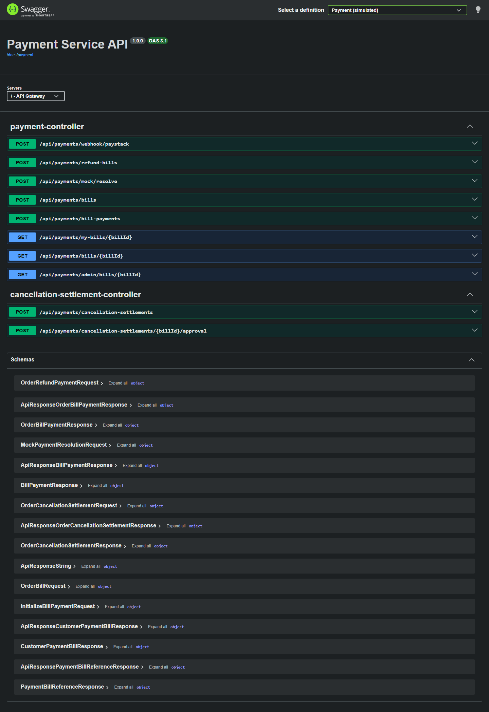
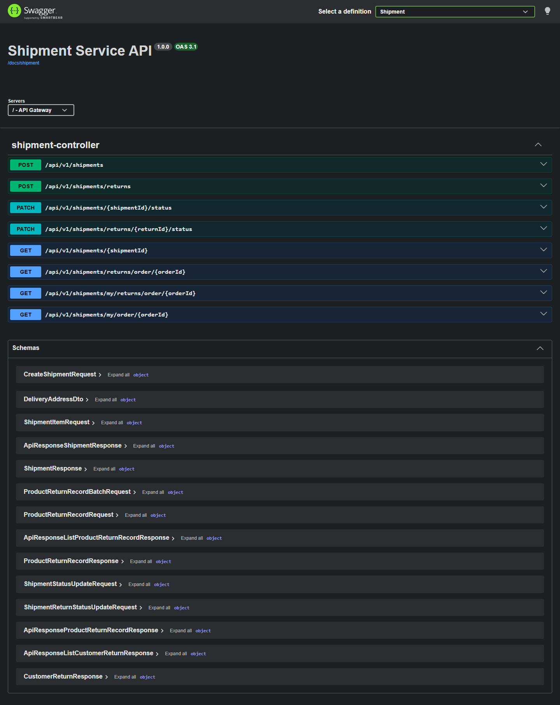

# API and Swagger gallery

[Back to README](../README.md)

The local gateway aggregates five generated OpenAPI documents. These pictures are read-only captures of Swagger UI from the local application; they contain no saved bearer token or submitted request results. They document API shape, not authentication bypass or an Internet deployment.

When running locally: [Gateway Swagger](http://localhost:8080/swagger-ui/index.html). This localhost link is for the presenter's computer and is not a public demo URL.

| API | Gateway document path | Examples of responsibilities |
| --- | --- | --- |
| Identity | /docs/identity | Customer registration/login, staff login, own profile, addresses, admin staff/account management |
| Product | /docs/product | Public catalogue and role-restricted catalogue/stock operations |
| Order | /docs/order | Owned orders, order bills, cancellation and refund workflows |
| Payment | /docs/payment | Owned bill/payment views and simulated payment/refund operations |
| Shipment | /docs/shipment | Owned tracking, staff shipment progression and returns |

Business APIs use bearer JWTs and service-level authorization/ownership. Public documentation does not make protected operations public. Staff/admin functions require their respective roles. Internal service callbacks are blocked at the gateway.

The selected [code pictures](CODE-HIGHLIGHTS.md) explain retry and delivery guards. Payments and refunds are simulated; no real provider is charged.

## Identity

## Product

## Order

## Payment — simulated

## Shipment

