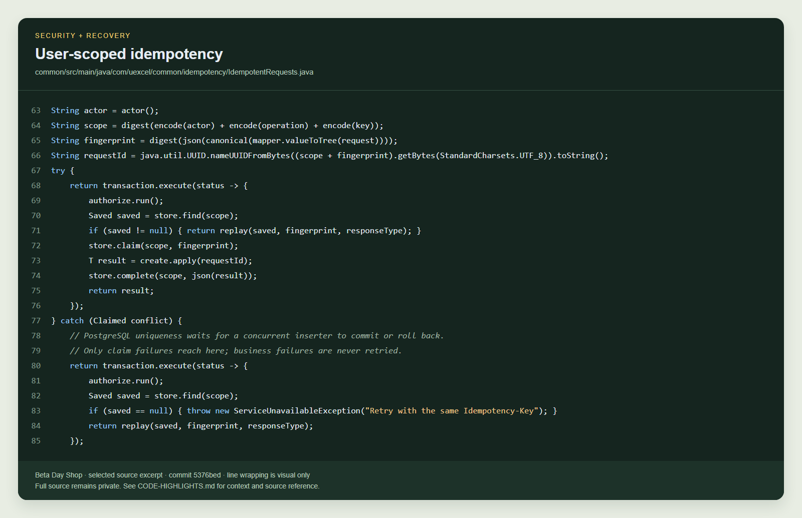
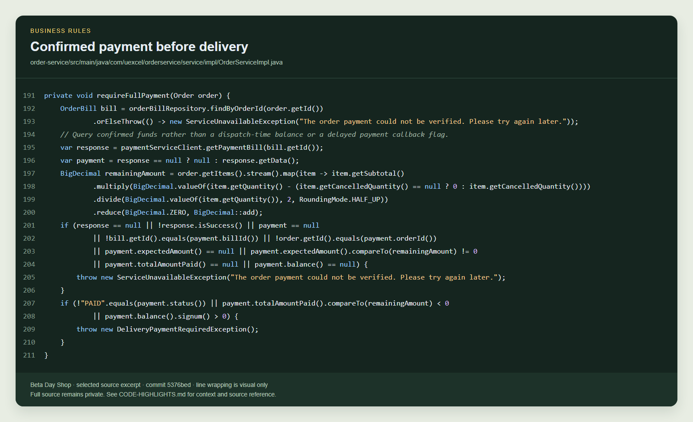
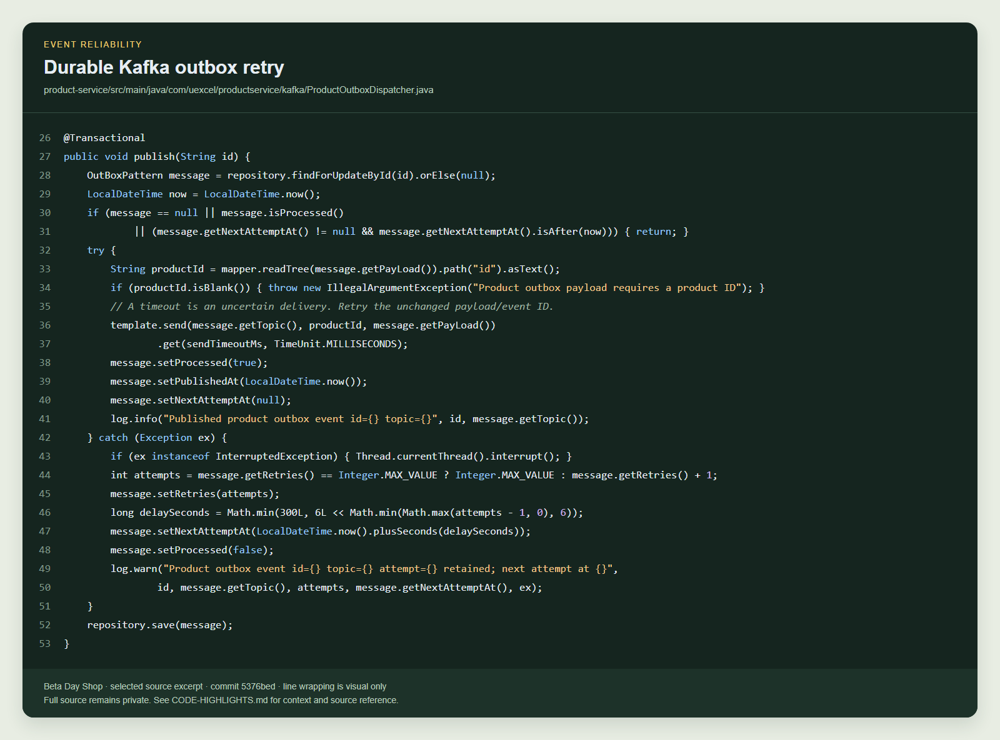
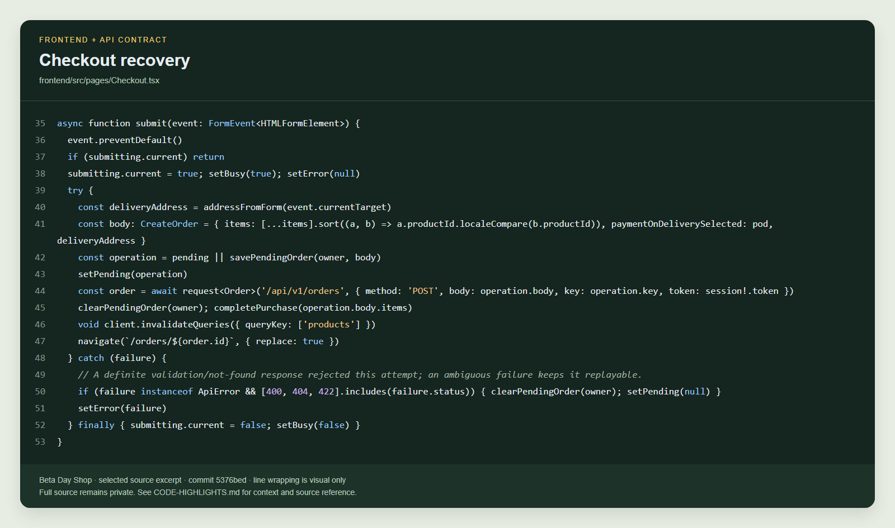

# Selected code highlights

[Back to README](../README.md)

These pictures are rendered from actual, selected source lines at commit **5376bed**. They reveal small implementation examples, not the complete private application. Source links require repository access. Wrapping in the pictures is visual only; line numbers refer to the original file.

## 1. User-scoped idempotency

Actor + operation + key scope the saved result. Authorization runs before both initial lookup and concurrent replay. A request fingerprint rejects changed input; a database uniqueness claim coordinates competing attempts.

This excerpt starts after key validation. The replay helper below it enforces the fingerprint match. Ownership policies are supplied by the calling service.

Source: [common/src/main/java/com/uexcel/common/idempotency/IdempotentRequests.java, lines 63–85](https://github.com/Uexcel2022/beta-day-shop/blob/5376bed5e8130698a943c1dfad0d18910f81e516/common/src/main/java/com/uexcel/common/idempotency/IdempotentRequests.java#L63-L85).

## 2. Confirmed payment before delivery

The delivered transition calls this guard. It queries the current payment bill, verifies order/bill identity and expected value, and requires confirmed full payment with no outstanding balance.

Missing or inconsistent payment data returns an unavailable error; insufficient funds raise DeliveryPaymentRequiredException. The shipment update cannot silently succeed.

Source: [order-service/src/main/java/com/uexcel/orderservice/service/impl/OrderServiceImpl.java, lines 191–211](https://github.com/Uexcel2022/beta-day-shop/blob/5376bed5e8130698a943c1dfad0d18910f81e516/order-service/src/main/java/com/uexcel/orderservice/service/impl/OrderServiceImpl.java#L191-L211).

## 3. Durable Kafka outbox retry

A row lock selects pending outbox work. The event is marked processed after the broker send acknowledges. Failures retain the message and schedule capped backoff; the unchanged event ID can be retried.

Consumers use durable event receipts to deduplicate replay. A timeout is uncertain delivery, so this design does not claim that Kafka magically eliminates duplicates.

Source: [product-service/src/main/java/com/uexcel/productservice/kafka/ProductOutboxDispatcher.java, lines 26–53](https://github.com/Uexcel2022/beta-day-shop/blob/5376bed5e8130698a943c1dfad0d18910f81e516/product-service/src/main/java/com/uexcel/productservice/kafka/ProductOutboxDispatcher.java#L26-L53).

## 4. Checkout recovery

The frontend saves the intended body and key before POST. It reuses a pending operation after interruption, and clears it after confirmation or a definite validation rejection.

An ambiguous failure preserves the pending operation. Server-side user-scoped idempotency returns the original order rather than creating a duplicate on retry.

Source: [frontend/src/pages/Checkout.tsx, lines 35–53](https://github.com/Uexcel2022/beta-day-shop/blob/5376bed5e8130698a943c1dfad0d18910f81e516/frontend/src/pages/Checkout.tsx#L35-L53).
